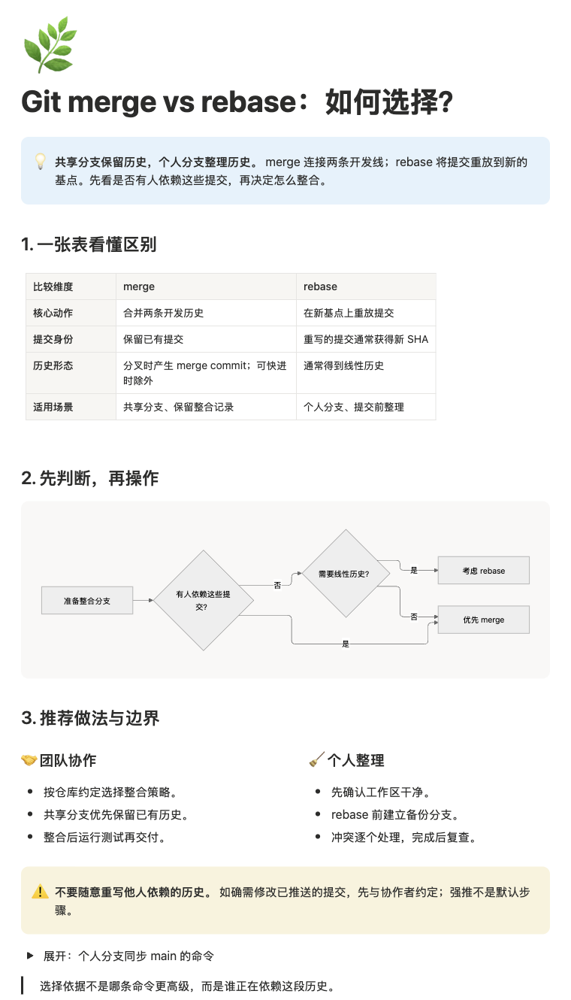

# Notion Visual Report

[简体中文](README.md) · English

An Agent Skill for writing reports, meeting summaries, and study notes in Notion using native visual blocks.

**Find the conclusion in 30 seconds. Read the details in 5 minutes.** Organize comparisons, research, summaries, and study notes with callouts, tables, Mermaid diagrams, columns, and toggles.

[Skill instructions](SKILL.md) · [Native block example](examples/report.notion.md) · [MIT License](LICENSE)



*Screenshot of a real Notion page. Mermaid is set to preview only; the command example is collapsed.*

## Installation

Requires a client that supports Agent Skills and a connected Notion MCP with write access to the destination page. Give a client that supports skill installation this prompt:

```text
Install notion-visual-report from https://github.com/Leonewu/notion-visual-report into my personal skills.
Use it when I create, rewrite, or organize Notion documents.
```

### Local installation for Codex

If the destination directory does not already exist, run:

```bash
git clone https://github.com/Leonewu/notion-visual-report.git "${CODEX_HOME:-$HOME/.codex}/skills/notion-visual-report"
```

Restart the client or start a new session, then confirm the skill is available. Automatic selection depends on client support.

## Usage

```text
Use notion-visual-report to write a Git rebase vs merge comparison in Notion.
Explain the tradeoffs with a table and flowchart, and create it under this page: <destination page URL>.
```

You can also ask for meeting notes, research summaries, or study notes and specify a destination page or database.

## Language

An explicitly requested output language takes priority. Otherwise, edits preserve the existing page's language, and new pages follow the language of your request. Chinese is the fallback only when no language can be determined. Titles, table headers, diagram labels, and other prose follow the output language; technical terms stay in English, and code and identifiers remain unchanged.

For example, a Chinese request that asks for an English report produces English output. The screenshot above is a Chinese example, not a language restriction.

## Verification and limitations

- Reads Notion's current enhanced Markdown spec before writing and fetches the saved page to check its structure.
- Diagrams and interactions need inspection in the actual Notion page. A successful fetch does not prove correct visual rendering.
- The example uses Notion enhanced Markdown; GitHub's preview does not show the final Notion rendering.

Issues and pull requests are welcome. Remove private document content and credentials before sharing. This project is not affiliated with Notion.
