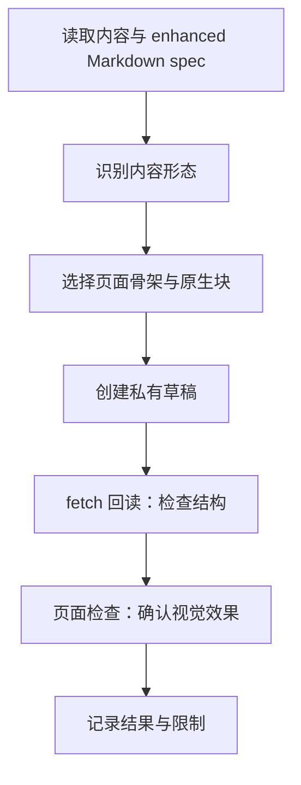

<callout icon="💡" color="blue_bg">
	**同一份内容应按阅读任务选择原生块。** 本页是 notion-visual-report 的验收样例，覆盖 table、Mermaid、columns、tabs、toggle 与 to-do；写入成功和视觉验收分别记录。
</callout>

<table_of_contents/>

## 1. 内容怎么选块

<table header-row="true" header-column="true">
	<tr>
		<td>内容</td>
		<td>选择</td>
		<td>读者能快速找到什么</td>
	</tr>
	<tr>
		<td>多维比较</td>
		<td>**table**</td>
		<td>选项差异与适用条件</td>
	</tr>
	<tr>
		<td>流程与结构</td>
		<td>**Mermaid**</td>
		<td>步骤、分支与关系</td>
	</tr>
	<tr>
		<td>两个并列观点</td>
		<td>**columns**</td>
		<td>左右对照的结论</td>
	</tr>
	<tr>
		<td>同一主题的不同视角</td>
		<td>**tabs**</td>
		<td>按角色切换的说明</td>
	</tr>
	<tr>
		<td>可选深读内容</td>
		<td>**toggle**</td>
		<td>不影响扫读的补充细节</td>
	</tr>
</table>

## 2. 从输入到验收



## 3. 并排阅读与按需展开

<columns>
	<column>
		### 30 秒扫读
		- 先读 TL;DR 的结论。
		- 通过目录定位问题。
		- 用表格快速比较。
	</column>
	<column>
		### 5 分钟深读
		- 顺着流程图理解步骤。
		- 展开细节和示例。
		- 根据检查项决定下一步。
	</column>
</columns>

<tabs>
	<tab icon="👀">
		读者视角
		先回答“结论是什么”，再给证据和行动。
	</tab>
	<tab icon="🛠️">
		作者视角
		先根据内容选择结构，再用原生块表达；避免为满足检查项添加无关图表。
	</tab>
</tabs>

<details>
<summary>展开：特殊字符与代码样例</summary>
	正文中的字面字符示例：\*星号\*、\[方括号\]、\<尖括号\>、\{花括号\}、竖线 \|、价格 \$5。
	**关键短语**保留强调，[GitHub 仓库](https://github.com/Leonewu/notion-visual-report)保留链接语法。
	```javascript
	const options = ["table", "mermaid", "columns"];
	const label = "<literal> $5 | *";
	```
</details>

## 4. 验收边界与下一步

<callout icon="⚠️" color="yellow_bg">
	**回读通过不等于视觉通过。** fetch 用于检查保存后的结构；Mermaid 是否显示为图、tabs 是否可切换、特殊字符是否按字面显示，需要打开页面检查。
</callout>

- [x] 按当前 enhanced Markdown spec 编写样例。
- [ ] 回读页面，确认各类原生块结构。
- [ ] 打开页面，检查表格、Mermaid、columns、tabs 和 toggle。
- [ ] 根据实际结果修订 skill 的自检规则。

> 好的可视化报告，让结论先被看见，让细节按需展开。
